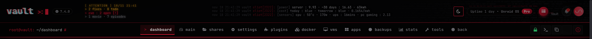

# Disaster Recovery

A terminal-style skin for the Unraid web UI: black, off-white and red, with a few nods to
*Mr. Robot* (`hello, friend.`) and to the CRT screens of the *Fallout* games.
It is an overlay on top of the **Aurora Theme** plugin (Black mode), not a replacement.



## What you get

- **Server name as a logo**: `vault >:` replaces the Unraid logo. The name is read from the page title
  (`<hostname>/<page>`), so it follows a renamed server. Its letters shift permanently (red / cyan slices).
- **Header report** (optional, fed by `status.json`): a verdict line `[ ATTENTION ] 18/11 21:41`, three key lines
  (`> 2 fixes · 8 todo`, `> cve : 2 open [!]`, `> 1 movie · 7 episodes`) and, centered in the free space, three
  log lines (`[power]`, `[cost]`, `[sensors]`) styled like syslog entries over a fading background of fake logs.
- **Search in the prompt**: the menu line `root@vault: ~/dashboard #` *is* the Unraid search box
  (same suggestions and navigation, `Ctrl+K` focuses it). The whole line is clickable.
- **Menu cleanup**: the right-hand buttons Disk Viewer, Feedback, Info, Log, Help and Logout are hidden;
  *Logout* is added to the Power menu instead. Terminal and File Manager stay.
- **Random "bugs"** (reference: Fallout CRT screens), one every 2 to 5 seconds, anywhere on the page:
  RGB letter-shift on a random text (sometimes lingering for a few seconds), reverse-video flash,
  page flicker, rolling scan bar. About 1 time out of 4 a second bug pops up almost at the same time.
- **Page shake**: 0.5 to 1 second, every 15 to 40 seconds (the footer stays still).
- Terminal look everywhere else: JetBrains Mono, scanlines, vignette, hex-dump background, square corners,
  outlined buttons, `root@host:~$` before section titles, phosphor glow on the header text.

Nothing is sent over the network by the skin itself. Effects are disabled when the OS asks for reduced motion,
and never run while you are typing or when a dialog is open.

## Requirements

- Unraid 7.x (developed on 7.4.0)
- [Aurora Theme](https://github.com/Tunefish92/Aurora-Theme) plugin (developed on `2026.11.17.1926`) with the **Black** theme
- Python 3 on the server (the build uses the standard library only)

## Install

```bash
git clone <this repo> /mnt/user/appdata/unraid-skins        # any persistent path
cd /mnt/user/appdata/unraid-skins/disaster-recovery
python3 status.py --demo        # optional: sample header data (see "Header data")
python3 build.py                # writes custom.css + custom.js into /boot/config/plugins/Aurora-Theme/
```

Reload the Unraid page. `build.py` embeds the font, the background and the header image as data URIs, so
nothing else has to be served. If Aurora already had a `custom.css` / `custom.js`, they are copied to `backup/`
on the first run.

**Remove**: `python3 build.py --off` (restore your own files from `backup/` if you had any).

## Header data

The header report is optional. Without `src/status.json` the skin simply shows the logo and the prompt.

`status.json` (written by `status.py`, read by `build.py`, see `examples/status.example.json`):

```json
{
  "verdict": "ATTENTION", "verdict_en": "ATTENTION", "headline": "tooltip text",
  "when": "18/11 21:41", "stamp": "nov 18 21:41:29", "proc": "elliot", "pid": 2322,
  "lines":  [ {"t": "2 fixes · 8 todo", "c": "amber"}, {"t": "cve : none", "c": "mut"} ],
  "syslog": [ {"tag": "power", "msg": "server : 9.92 · ~30 days : 16.62 · 63kwh"},
              {"tag": "cost",  "msg": "today : red · tomorrow : blue", "warn": true} ]
}
```

- `lines[].c`: `green`, `amber`, `red`, `mut` (grey) or `txt`.
- `syslog[].warn`: appends ` [!]` to the line.
- Write it from any script you like. `status.py` is the reference producer: it reads a nightly report
  (`report.json` with `verdict`, `cve[].corrige`, `corrections[]`, `a_faire[]`) and a `metrics.json`
  (`generated`, `arr.radarr.imported[]`, `arr.sonarr.imported[]`, `ups.runtime_min`):
  `python3 status.py report.json metrics.json`, then `python3 build.py`.
- The report this was built for is produced every night by a separate agent; it is **not** part of this repo.

### Home Assistant (optional)

`status.py` can add the `[power]`, `[cost]` and `[sensors]` lines from Home Assistant. Copy
`config.example.json` to `config.json`, put a long-lived access token in `ha.token`, and map your entities.
Any entity you leave out is skipped. `config.json` and `*.token` are git-ignored.

## Customise

| What | Where |
|------|-------|
| Bug rhythm (2 to 5 s), double-bug chance (25 %), bug types and weights | `src/skin.js`, section `3 bis`, functions `loop()` and `fire()` |
| Page shake (0.5–1 s every 15–40 s) | `src/skin.js`, section `3` |
| Hidden menu buttons | `src/skin.css`, rule "barre de droite : ménage" |
| Header height (76 px) | `src/skin.css`, `#header { height: ... }` |
| Colors | `--el-*` variables at the top of `src/skin.css` |

Regenerate the generated images (needs Pillow and *DejaVu Sans Mono*, e.g. `apt install fonts-dejavu-core`):

```bash
python3 src/header.py     # fake-log background of the header
python3 src/texture.py    # hex-dump page background
```

## Notes and limits

- The header report is hidden below 1500 px of window width.
- The search box replaces Unraid's `gui_search` entry point; Awesomplete (bundled with Unraid) provides the suggestions.
- Built and checked in Chrome / Chromium only.
- No login-page skin yet (`build.py` would install `src/skin-login.css` as `custom-login.css` if you add one).

## Credits and licenses

- Font: [JetBrains Mono](https://github.com/JetBrains/JetBrainsMono), SIL Open Font License 1.1 (`src/OFL.txt`).
- Inspiration for the CRT effects (phosphor glow, scanlines, flicker, rolling bar, RGB text separation):
  [Retro CRT terminal screen in CSS + JS](https://dev.to/ekeijl/retro-crt-terminal-screen-in-css-js-4afh),
  [Vintage terminal effect in CSS3](https://blog.carbonfive.com/vintage-terminal-effect-in-css3/),
  [Fallout.css](https://www.cssscript.com/retro-futuristic-fallout/).
- The skin's own code and images are released under the [MIT License](../LICENSE). The embedded font keeps its own license (SIL OFL 1.1, see above).
